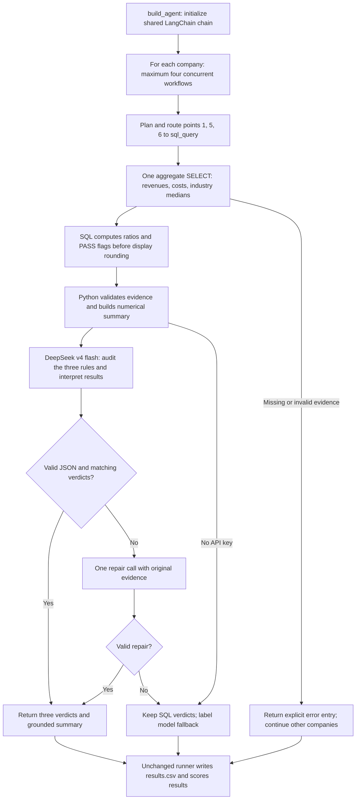

# FTEC5660 Homework 3: Fisher Analysis Agent

A LangChain workflow for Fisher points **1, 5 and 6**, using the required
`deepseek-v4-flash` model and only the supplied company-data tools.

## Run

Use Python 3.10 or newer (validated with Python 3.12).

```bash
python3 -m venv .venv
source .venv/bin/activate
pip install -r requirements.txt
```

Create a local `.env` file containing `DEEPSEEK_API_KEY=your_key_here`, then run:

```bash
python3 hw3.py --data-folder public_test
```

The unchanged runner writes `results.csv`. Keep `.env` private and out of Git.
If no key is present, the program explicitly reports **SQL-only fallback**;
that mode checks the numerical rules but does not constitute a live model test.
The grader can provide its own key through the environment or `.env`.

Run the isolated regression checks without API calls:

```bash
python3 -m unittest -v test_agent
```

## Homework 3 solution

### My three points and rules

The Fisher questions below are paraphrased from the point definitions reproduced
in the supplied `hw3.py`, attributed there to *Common Stocks and Uncommon
Profits*, Part One, Chapter 3. The thresholds are my operational rules for this
assignment, not numerical thresholds prescribed by Fisher.

| Point | Why I chose it | PASS rule | Evidence |
| --- | --- | --- | --- |
| **1: Market potential for sales growth** | Growth relative to the industry helps distinguish company performance from a generally expanding market. | PASS when cumulative revenue growth from FY2023 to FY2025 is at least the company's own industry's two-year revenue-growth median. | `orders`, `company`, `industry_medians.revenue_growth_2y_pct` |
| **5: Worthwhile profit margin** | Revenue growth is less attractive when little of it becomes operating profit; industry comparison avoids treating different sectors as identical. | PASS when FY2025 operating margin is at least the company's own industry's operating-margin median. | `orders`, `monthly_costs`, `company`, `industry_medians.operating_margin_pct` |
| **6: Maintaining or improving margins** | The direction of profitability adds information that its current level cannot provide. | PASS when FY2025 operating margin is at least FY2023 operating margin; equality counts as maintenance. | `orders`, `monthly_costs` for FY2023 and FY2025 |

For year *y*, the calculations are:

```text
Revenue_y = SUM(orders.amount in year y)
Operating_costs_y = SUM(cost_of_sales + selling_admin + research_development)
Operating_margin_y_pct = 100 * (Revenue_y - Operating_costs_y) / Revenue_y
Two_year_growth_pct = 100 * (Revenue_2025 / Revenue_2023 - 1)
Margin_change_pp = Operating_margin_2025_pct - Operating_margin_2023_pct
```

The database uses USD thousands; all numerator and denominator amounts use the
same units, so the ratios need no currency conversion. The margin change is in
**percentage points**, whereas revenue growth is a percentage. I use complete
calendar fiscal years and do not compare partial FY2026 revenue against a full
year. Orders and costs are aggregated separately before joining, preventing a
many-to-many join from multiplying the totals. The industry join uses the
company's actual industry, not an average of unrelated industries.

### Design



This is a planned, tool-using LangChain workflow. Because all selected points use
structured financial evidence, the plan routes them to `sql_query` and makes
exactly one aggregate query per company. Interviews and management documents
are unnecessary for these rules, so the agent uses zero interviews and does not
rely on management claims. A shared `ChatPromptTemplate -> ChatDeepSeek ->
JsonOutputParser` chain audits the evidence and writes a concise interpretation.
The prompt asks the model to reflect on the distinction between margin level and
trend. Python then checks the model's verdicts against SQL and rejects invalid
JSON, inconsistent verdicts, or numerical claims in the interpretation. One
repair call is allowed. All numeric statements in the final summary are rendered
from tool evidence; the model adds the qualitative interpretation. Company
workflows run concurrently with a limit of four.

The SQL returns integer comparison flags because the provided tool rounds
floating-point values to two decimals. Comparing rounded numbers in Python or
in the model could otherwise change a borderline decision. Revenue denominators,
finite values and the presence of twelve months in both evaluation years are
validated before issuing verdicts. This completeness check is tailored to the
assignment dataset; a business with legitimate zero-sales months would need a
more explicit missing-data policy.

### Reliability and constraints

- The only model is `deepseek-v4-flash`; company evidence comes only from the supplied `sql_query` LangChain tool.
- No company names, folder names or public verdicts are embedded in the agent. The unchanged runner reads the answer key only after analysis for scoring.
- The original tools, runner and scoring code below the marked boundary are unchanged.
- A failed model call retains evidence-derived verdicts and labels the summary as a fallback. Failed evidence produces an explicit company error and missing verdicts rather than invented answers.
- API requests have a 40-second SDK timeout and one SDK retry. Each chain invocation has a 60-second outer timeout, with at most two invocations per company. The SQL call has a 20-second timeout. For twenty companies in five batches of four, these bounds are comfortably below the thirty-minute grading limit under normal cancellation behavior.
- The model interpretation still requires semantic review: matching verdicts and valid JSON do not prove that every sentence is justified.

### Public-test results

A live run using the configured DeepSeek key processed all **20 companies**:

| Measure | Observed result |
| --- | --- |
| Correct verdicts | **60 / 60** |
| True-PASS verdicts correctly identified | **42 / 42 = 100%** |
| True-FAIL verdicts correctly identified | **18 / 18 = 100%** |
| Balanced point accuracy | **100.0%** |
| Companies with disagreements | **None** |
| Companies using model fallback | **0 / 20** |
| Interviews used | **0** |

The balanced score is `(42/42 + 18/18) / 2 = 100%`. The saved live output is
[validation/public_test_results.csv](validation/public_test_results.csv).
An earlier SQL-only run also scored 60/60; the reported live run additionally
verified that the actual required model completed its audit for every company.

| Company | Point 1 | Point 5 | Point 6 | Correct |
| --- | --- | --- | --- | --- |
| ashgrove_labs | PASS | PASS | FAIL | 3/3 |
| aurel_systems | PASS | PASS | PASS | 3/3 |
| bramble_labs | PASS | PASS | PASS | 3/3 |
| cobalt_holdings | FAIL | PASS | FAIL | 3/3 |
| copperfield_technologies | PASS | PASS | PASS | 3/3 |
| driftwood_systems | FAIL | PASS | PASS | 3/3 |
| dunmore_holdings | PASS | PASS | PASS | 3/3 |
| elmstead_technologies | PASS | PASS | PASS | 3/3 |
| emberly_systems | PASS | PASS | FAIL | 3/3 |
| everline_dynamics | PASS | FAIL | PASS | 3/3 |
| falcrest_technologies | PASS | FAIL | PASS | 3/3 |
| fernhill_group | PASS | PASS | PASS | 3/3 |
| granite_group | PASS | PASS | FAIL | 3/3 |
| halcyon_works | FAIL | FAIL | PASS | 3/3 |
| hollins_group | PASS | PASS | PASS | 3/3 |
| ironbark_technologies | FAIL | FAIL | PASS | 3/3 |
| juniper_industries | FAIL | PASS | PASS | 3/3 |
| kestrel_technologies | FAIL | PASS | PASS | 3/3 |
| lindale_holdings | PASS | FAIL | FAIL | 3/3 |
| northwind_group | PASS | FAIL | FAIL | 3/3 |

There were no public-answer disagreements to diagnose. The examples also show
why the points should be judged separately: Ashgrove Labs passed growth and
margin level but failed margin trend, while Everline Dynamics passed growth
and margin trend but failed margin level. These names are examples from the
saved results, not inputs to the agent's rules.

A second live run from a clean clone of the starter with the solution applied
also scored **60/60**, with **zero model fallbacks**, in **14.37 seconds**.
The clean checkout had no `.env`; the key was supplied through the process
environment. It used the same installed dependency environment. See
[validation/clean_run.txt](validation/clean_run.txt) and
[validation/clean_public_test_results.csv](validation/clean_public_test_results.csv).

Nine offline regression tests passed. They cover malformed evidence,
full-precision comparison flags despite rounded displays, per-company failure
isolation, correction of conflicting model verdicts, API-failure fallback,
rejection of invalid model output, the real LangChain prompt/parser with a
mocked model, tool-name routing, and transparent handling of a missing key.
These mocked tests supplement the live API run; they do not replace it.

### Limitations

The public set validates agreement with the assignment labels, not investment
performance or a guaranteed private-test score. Historical revenue growth is a
proxy for market potential and does not establish that growth will continue.
Comparing margin endpoints captures the net change but can miss intervening
volatility and does not explain which management actions caused it. Broader
investment research would require additional evidence and separate rules.
The thresholds were checked against the public examples, so those examples
should not be described as an independent out-of-sample evaluation.

### References and preparation

- Philip A. Fisher, *Common Stocks and Uncommon Profits*, Part One, Chapters 3-4; selected point definitions are reproduced in the supplied starter code.
- [Course starter repository](https://github.com/BINH2702/FTEC5660-HW3): data schema, allowed tools and evaluation protocol.
- [LangChain ChatDeepSeek integration](https://docs.langchain.com/oss/python/integrations/chat/deepseek): model initialization and async integration. Documentation was consulted for implementation, not as company evidence.

This submission was prepared with AI assistance. The implementation and reported
results were validated with the tests described above.

## Task 2: Reflection

See [REFLECTION.md](REFLECTION.md) for the reflection on AI sycophancy and
AI-psychosis, including their relationship to evidence, uncertainty and the
design of an investment-analysis agent.
